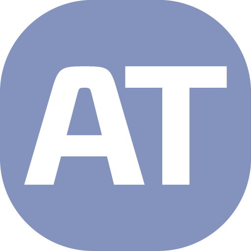
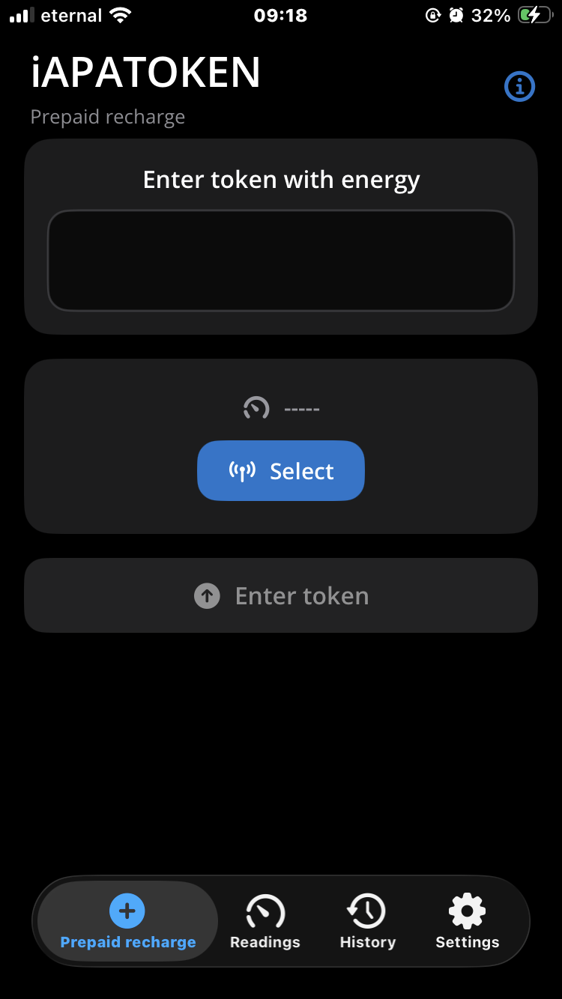
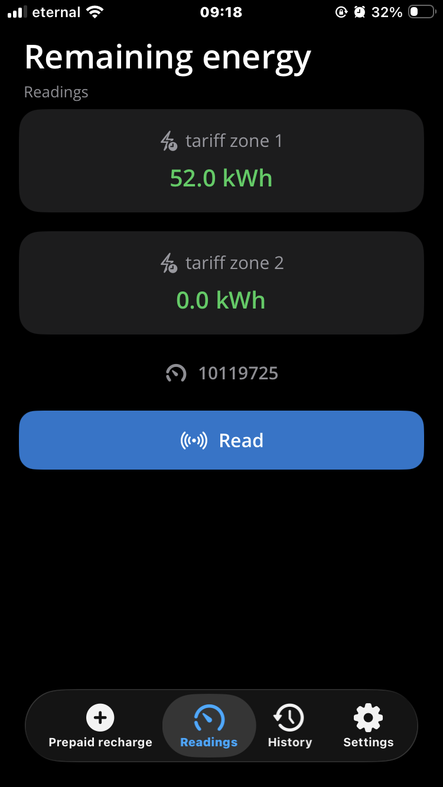
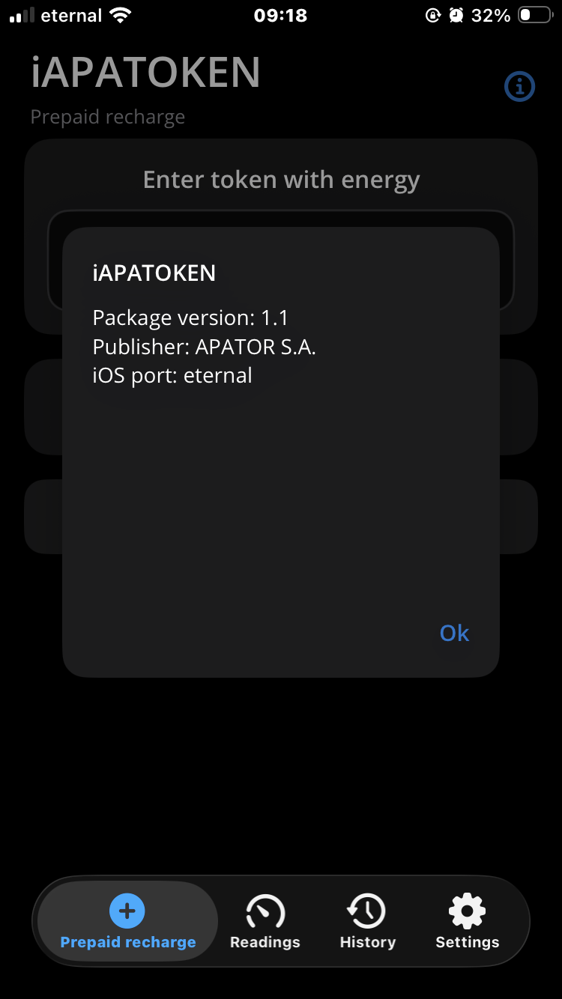

<div align="center">



# iAPATOKEN

**Natywna aplikacja iOS (SwiftUI) dla przedpłatowych liczników energii APATOR**

Port aplikacji **APATOKEN (Android / .NET MAUI)** — komunikacja DLMS/HDLC przez Bluetooth Low Energy.

`SwiftUI` · `CoreBluetooth` · `iOS 26.2+` · `EN / FR`

</div>

---

## 📱 Zrzuty ekranu

| Doładowanie | Odczyty | O aplikacji |
|:---:|:---:|:---:|
|  |  |  |

---

## ✨ Co to jest

iAPATOKEN to towarzysz przedpłatowego licznika energii APATOR: wysyła kody doładowania,
odczytuje saldo obu stref taryfowych i prowadzi historię doładowań. Aplikacja rozmawia
z licznikiem bezpośrednio przez BLE, realizując pełny stos **DLMS/HDLC** (SNRM/UA,
ramki I/RR, LLC, asocjacja pre-established klienta COSEM 41) — bez bramki, bez chmury.

Interfejs jest napisany od zera w SwiftUI w duchu platformy: karty na grupowanym tle,
ikony SF Symbols, **jasny i ciemny motyw zgodny z ustawieniami systemu**.

---

## 📊 Status

### Działa — potwierdzone na prawdziwym liczniku

| Funkcja | Opis |
|---|---|
| ✅ Skanowanie i wybór licznika | Filtr BLE jak w oryginale (nazwy zaczynające się od `APA`), zapis urządzenia |
| ✅ Połączenie i negocjacja HDLC | DISC→DM, SNRM→UA (200/200 B), poprawne domykanie sesji |
| ✅ Odczyt sald | Obie strefy taryfowe (IC112, przelicznik −1 → kWh) |
| ✅ Wysyłka kodu doładowania | ActionRequest → ActionResponse (IC115), pełne parsowanie statusu |
| ✅ Obsługa błędnego kodu | Nieprawidłowy kod poprawnie odrzucany przez licznik z czytelnym komunikatem |
| ✅ Historia doładowań | Lokalny plik `history.csv`, grupowanie po liczniku, widok szczegółów |
| ✅ Dziennik portu (debug) | Podgląd ruchu BLE/HDLC w Ustawieniach, z kopiowaniem do schowka |
| ✅ Motyw systemowy | Jasny i ciemny wygląd, adaptacyjna paleta |
| ✅ Lokalizacja | Angielski i francuski, czcionki Open Sans |

### W toku

| Funkcja | Opis |
|---|---|
| ⚠️ Doładowanie prawidłowym kodem | Cała ścieżka sukcesu jest zaimplementowana (zapis do historii, komunikat z kwotą), ale **niepotwierdzona jeszcze ważnym kodem** na liczniku |

### Ograniczenia

| | Opis |
|---|---|
| ➖ Ikona aplikacji | Wklejana po buildzie (ograniczenie `actool` w tym SDK — patrz sekcja Budowanie) |
| ➖ Eksport historii | Brak udostępniania CSV z poziomu UI; plik zapisywany lokalnie w Application Support |
| ➖ Adres urządzenia | Na iOS to UUID `CBPeripheral`, a nie MAC jak na Androidzie — wybór licznika nie przenosi się między platformami |
| ➖ Wersja systemu | Wymagany **iOS 26.2 lub nowszy** |

---

## 🛠 Budowanie

```bash
# symulator
xcodebuild -project APATOKEN.xcodeproj -target APATOKEN \
  -sdk iphonesimulator -configuration Debug ARCHS=x86_64 build

# urządzenie (bez podpisu)
xcodebuild -project APATOKEN.xcodeproj -target APATOKEN \
  -sdk iphoneos -configuration Debug ARCHS=arm64 \
  CODE_SIGNING_ALLOWED=NO CODE_SIGNING_REQUIRED=NO build
```

Produkcja buildu: `build/Debug-iphoneos/iAPATOKEN.app`.

> **Uwaga — ikona:** w tym zestawie SDK `actool` nie kompiluje prawdziwej zawartości
> katalogu zasobów, dlatego ikony są doklejane do `.app` po buildzie
> (`AppIcon29x29@2x/3x`, `AppIcon40x40@2x/3x`, `AppIcon60x60@2x/3x`, `AppIcon1024`)
> wraz z wpisem `CFBundleIcons` w `Info.plist` (PlistBuddy).

**Pakowanie IPA:**

```bash
mkdir -p Payload
cp -R build/Debug-iphoneos/iAPATOKEN.app Payload/
zip -qr iAPATOKEN.ipa Payload
```

**Instalacja:** podpisz IPA dowolnym narzędziem side-load (np. Feather) i zainstaluj na iPhone.

---

## 🗂 Struktura kodu

```
APATOKEN/
├── APATOKENApp.swift           — punkt wejścia, rejestracja czcionek
├── BLE/DspsBlePort.swift       — port szeregowy po BLE (CoreBluetooth, SPS)
├── Comm/MeterTransaction.swift — przepływy COSEM: odczyt, doładowanie
├── Dlms/                       — HDLC, APDU, modele statusu tokena
├── Views/                      — SwiftUI: 4 zakładki, motyw, popupy
├── Core/                       — lokalizacja (L), narzędzia bajtów
├── Model/ · Persist/           — modele, historia CSV, ustawienia
└── Resources/                  — OpenSans, Localizable.xcstrings, ikona
```

---

## 🙏 Podziękowania

- Oryginalna aplikacja **APATOKEN** — © **APATOR S.A.**
- Port na iOS — **eternal**

> Projekt nieoficjalny, stworzony w celach edukacyjnych. Nie jest powiązany
> z APATOR S.A. Znaki towarowe należą do ich właścicieli.
